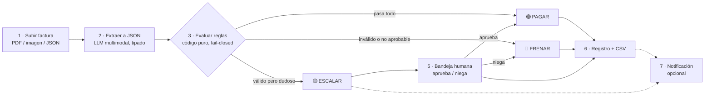
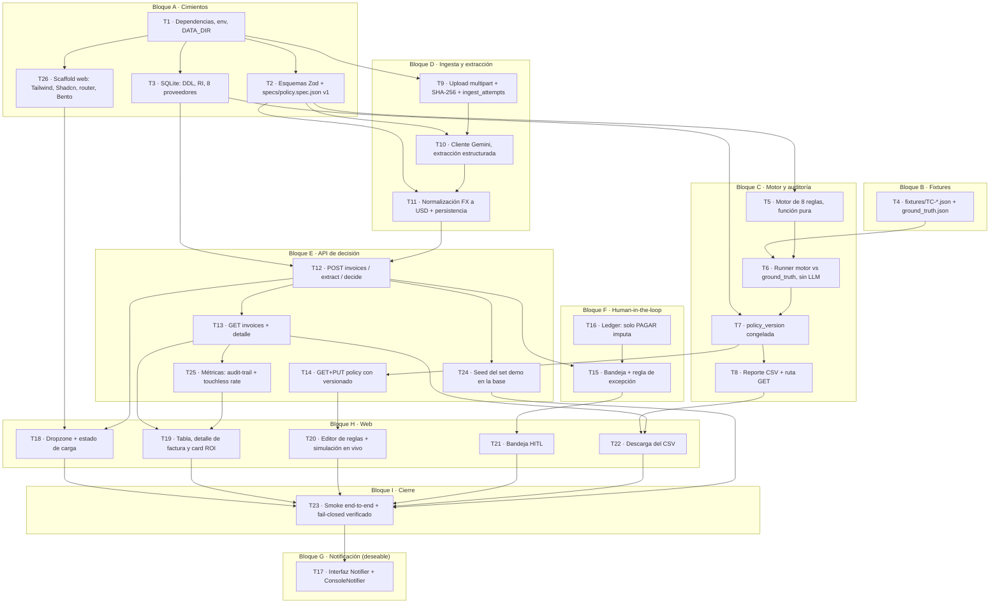

# Backlog de Implementación — MVP Faktur / Blinka PayAgent

> **Estado:** backlog completo. Las 6 decisiones de producto están tomadas y registradas en §7. Sin bloqueantes.
> **Stack:** el aceptado en `docs/decisiones/0001-stack-ts-node-react.md` (TypeScript/Node + Fastify + React). El MVP §9 recomienda Python/FastAPI, pero el ADR ya decidió por TS y `AGENTS.md` prohíbe copiar los excerpts en Python de los docs de referencia.
> **Método:** Spec-Driven Development. Cada tarea traza a un spec (`S#`) y a una fuente.

---

## 1. Fuentes y cómo se combinaron

| Fuente | Qué aporta |
|:---|:---|
| `diagramas/*.mmd` | **Fuente autoritativa** de la precedencia, el ciclo de vida, la regla de excepción HITL y el versionado de política. Commiteada en `194f4ef`. |
| `docs/planteamiento_mvp_reto_blinka.md` | Alcance de 7 piezas, API de 7 endpoints, CSV de 14 columnas, orden de construcción en 3 bloques |
| `docs/PRD_Faktur.md` | RF-1..RF-8, `reason_code` canónicos, TC-01..TC-10, metas de la rúbrica, Bento Grid + Tailwind + Shadcn |
| `docs/propuesta_modelo_ER_faktur.md` | Diccionario de entidades, RI-1..RI-10, diagrama ER |
| `docs/decisiones/0001-stack-ts-node-react.md` | Stack real: Fastify 5 + React 19 + compose |
| `odd/tasks/faktur-mvp.md` | Los specs `S1..S7` y las tareas `T1..T4` ya abiertas. Se conservan tal cual y son el Bloque C de este backlog. |

**Precedencia de fuentes:** `diagramas/` y el MVP §5 coinciden entre sí y **superseden** la tabla RF-4 del PRD, que es el único documento que se contradice. Ver §5.

**Estado actual del repo:** `api/src/app.ts` solo sirve `/api/health`, `web/src/App.tsx` es el arranque de Vite, `specs/` y `fixtures/` están vacíos. El MVP arranca de cero.

---

## 2. Flujo único que implementa todo el backlog

Regla de oro que atraviesa todo el backlog: **si algo no se puede verificar, no se paga**. El camino por defecto termina en ESCALAR, nunca en PAGAR.

---

## 3. Grafo de dependencias

`A → B` significa que A tiene que estar terminada antes de empezar B.
C y D son paralelizables: los fixtures (D) no dependen del motor (C).

**Ruta crítica:** `T1 → T2 → T5 → T6 → T7 → T8`. Es el "bloque 1" del MVP §14 (ruta completa y fea, JSON en vez de PDF, sin UI): apenas esté, ya hay agente funcionando.

**Nota sobre G:** T17 (notificación) es la pieza sacrificable del MVP §1. Aparece como dependencia de T23 solo para marcar que la demo en vivo la ejercita; si se sacrifica, T23 cierra igual y se borra la flecha.

---

## 4. Specs

Los siete primeros vienen de `odd/tasks/faktur-mvp.md` y no se tocan. Los siguientes cubren las piezas del MVP que ese archivo no alcanzaba.

| # | Spec | Cubre |
|:--|:---|:---|
| S1 | Tres estados deterministas: PAGAR, FRENAR o ESCALAR A HUMANO. El LLM solo extrae a JSON tipado, decide código puro. | 2, 3 |
| S2 | Cero pagos aprobados fuera de política: fail-closed, default ESCALAR nunca PAGAR. | 3 |
| S3 | FRENAR ≠ ESCALAR. FRENAR es inválido, no aprobable. HITL solo sobre ESCALAR, una sola resolución. | 3, 5 |
| S4 | Toda factura genera AuditRecord con `reason_code` + explicación legible, y `policy_version` obligatoria. | 6 |
| S5 | **Dedup doble sobre dos niveles:** `invoices.file_hash` UNIQUE para la factura canónica, y `UNIQUE(vendor_id, invoice_number)` para la tupla lógica. | 1, 3 |
| S6 | Solo PAGAR final escribe `ledger_entries`; FRENAR y ESCALAR-pendiente no mueven saldo. | 3, 4 |
| S7 | Set de 12 TC con veredictos TC-01..TC-12 según las tablas de §5. | 11 |
| **S8** | **Ingesta:** se acepta PDF, imagen o JSON; el SHA-256 se calcula al recibir, antes de llamar al LLM; se bloquea el doble envío. | 1 |
| **S9** | **Extracción:** LLM multimodal, `temperature=0`, salida JSON con schema estricto. Si la validación falla → FRENAR por dato crítico. | 2 |
| **S10** | **Moneda:** el monto se normaliza a USD con la tasa vigente y se congela en la fila. Fuera de `allowed_currencies` → FRENAR. | 2, 4 |
| **S11** | **Reglas configurables:** la política se edita desde la pantalla y se versiona; mover un umbral cambia decisiones nuevas sin reescribir historia. Un `PUT` inválido responde 422 y no crea versión. | 4 |
| **S12** | **HITL:** aprobar deja la factura aprobada y asienta en el ledger; negar la deja frenada. La segunda resolución es idempotente y no duplica el pago. | 5 |
| **S13** | **Reporte:** el CSV se reconstruye con JOIN de las tablas de ingesta, facturas, proveedores, decisiones, aprobaciones y políticas, con `motivo_legible` en lenguaje natural. | 6 |
| **S14** | **Gate de confianza:** es la regla 1. Datos ilegibles o incompletos → FRENAR. Datos completos con confianza bajo el umbral → ESCALAR. | 3, 13 |
| **S15** | **Regla de excepción:** al aprobar, el motor re-chequea las reglas 1-3 (frenos duros) con la `policy_version` del caso. Si alguna dispara, la aprobación responde 409 y no habilita PAGAR. | 5 |
| **S16** | **Congelamiento de pendientes:** un `PUT /policy` no re-evalúa las aprobaciones pendientes; quedan congeladas en la versión con la que se escalaron. Las ya decididas no se tocan. | 4 |
| **S17** | **Ciclo de vida:** `invoices.status` recorre `recibida → extraída → decidida / frenada / pendiente_aprobación → aprobada / negada`, con las transiciones prohibidas del diagrama de estados. | 4 |
| **S18** | **Métricas:** se expone presupuesto restante, total procesadas y touchless rate para la card Health & ROI. | 8 |
| **S19** | **Intentos de ingesta:** todo upload genera una fila en `ingest_attempts`. Un reenvío con hash ya conocido no crea factura: genera un intento `DUPLICADA` que referencia la canónica y su propia decisión FRENAR, con motivo y fecha del registro original. | 1, 3, 6 |
| **S20** | **Categoría:** la categoría vive en `vendors.category` y gobierna la regla 6 contra `policy_category_budgets`. Una factura sin proveedor no tiene categoría y frena antes. | 3, 4 |

---

## 5. Decisiones que el repo ya tomó (no reabrir)

`diagramas/` está commiteada y es coherente con el MVP §5.

**Precedencia del motor** (`ds01_ingesta_decision.mmd` como fuente primaria; `flujo_decision_mermaid.mmd` y `estados_factura.mmd` la confirman):

| Regla | Condición | Veredicto | `reason_code` |
|:--|:---|:---|:---|
| 1 | Datos críticos ilegibles o incompletos | 🔴 FRENAR | `ERR_INVALID_DATA` |
| 1 | Datos completos pero confianza bajo el umbral | 🟡 ESCALAR | `ALERT_LOW_CONFIDENCE` |
| 2 | Duplicado: hash conocido, o `(vendor, numero_factura)` repetido | 🔴 FRENAR | `ERR_DUPLICATE_INVOICE` |
| 3 | Beneficiario en lista bloqueada | 🔴 FRENAR | `ERR_BLACKLISTED_VENDOR` |
| 4 | Beneficiario no está en la lista permitida | 🟡 ESCALAR | `ALERT_NEW_VENDOR` |
| 5 | No cuadra con lo acordado: `total_usd > promedio histórico × factor` | 🟡 ESCALAR | `ALERT_VENDOR_DRIFT` |
| 6 | Presupuesto insuficiente, del periodo primero y de categoría después | 🟡 ESCALAR | `ALERT_BUDGET_OVERRUN` / `ALERT_BUDGET_TIGHT` |
| 7 | Monto supera el umbral de aprobación autónoma | 🟡 ESCALAR | `ALERT_THRESHOLD_EXCEEDED` |
| 8 | Pasa todo lo anterior | 🟢 PAGAR | `SUCCESS_TOUCHLESS_STP` |

`estados_factura.mmd` confirma la frontera: **reglas 1-3 son frenos duros (FRENAR) y las 4-7 son escalables**. De ahí sale `ds02`: al aprobar se re-chequean solo las reglas 1-3, y si alguna dispara la excepción no habilita PAGAR.

> **El PRD §RF-4 contradice esto.** Su tabla pone el presupuesto en la regla 2 como `ERR_BUDGET_OVERRUN` → FRENAR, e invierte el resto del orden. Como `diagramas/` y el MVP §5 coinciden entre sí y el PRD es el único disidente, este backlog sigue a los diagramas. El efecto real: el sobregiro de presupuesto es escalable con un humano, no freno duro, y TC-06 queda determinado sin ambigüedad.

**Cambio de enum que esto implica:** `ERR_BUDGET_OVERRUN` del PRD queda sin uso (era FRENAR) y se agrega `ALERT_BUDGET_OVERRUN` y `ALERT_LOW_CONFIDENCE`. Los nueve `reason_code` del Apéndice A del PRD no alcanzan: `ERR_BUDGET_OVERRUN` queda sin uso (era FRENAR) y se agregan `ALERT_BUDGET_OVERRUN` y `ALERT_LOW_CONFIDENCE`. El enum congelado en T2 lleva **diez**.

**Resoluciones de la aprobación** (`ds02_aprobacion_humana.mmd`):

| Situación | Respuesta |
|:---|:---|
| Aprobación ya cerrada (doble clic) | `200`, evento idempotente, **no** duplica el pago |
| La factura está frenada | `409`, se audita el intento |
| La regla de excepción no se permite (freno duro) | `409`, la excepción no habilita PAGAR |
| Aprobado y la excepción se permite | `200` PAGAR + asento en ledger + cierre de la aprobación |
| Negado | `200`, la factura queda frenada + cierre de la aprobación |

El cierre es atómico: ledger + aprobación + factura + auditoría en una transacción.

**Versionado de política** (`ds03_cambio_reglas.mmd`): un `PUT` válido crea la versión N+1 inmutable y desactiva la N; las facturas decididas no se tocan y las aprobaciones pendientes quedan congeladas en la versión con la que se escalaron.

**Ciclo de vida** (`estados_factura.mmd`): siete estados. Las transiciones prohibidas (`frenada → aprobada`, `negada → aprobada`, `aprobada → frenada`, `decidida → pendiente_aprobación`) responden 409 y se auditan.

**Decisiones propias, marcadas como tales:**

- `decisions` es append-only (RI-8) y guarda el veredicto original con su `policy_version`. El estado actual vive en `invoices.status`, y la resolución humana es fila nueva en `approvals` más un evento de auditoría. Esto resuelve la contradicción interna del ER §2.7 (que dice a la vez `UNIQUE(invoice_id)` y "N decisiones") y evita mutar la `explanation` de una fila que RI-8 declara inmutable.
- El CSV tiene **una fila por decisión**. El reenvío duplicado aporta su propia fila con el `invoice_id` de la canónica y un `motivo_legible` que cita la fecha del registro original, que es exactamente la evidencia que pide el MVP §6.
- El ground truth evalúa cada fixture **en aislamiento** con presupuesto y ledger base fijos, salvo TC-03 (siembra la factura previa que vuelve duplicado el reenvío) y TC-10 (siembra el gasto de categoría que deja el saldo en negativo). En secuencia contra un ledger compartido, `budget_remaining` dependería del orden de archivo y el ground truth quedaría flaky.
- Los tests corren contra un `DATA_DIR` temporal por corrida, nunca contra la base de demo: `just check` corre en el contenedor contra el repo montado y una escritura ahí ensuciaría lo que la demo muestra.

---

## 6. Tareas

Cada tarea lleva: qué hace, por qué, traza, dependencias y criterio de "hecho". El commit va en inglés, Conventional Commits.

### Bloque A — Cimientos

#### T1 · Dependencias, variables de entorno y persistencia de datos

**Síntesis.** Agrega al workspace: `zod` (el Pydantic del PRD), `@google/genai`, `@fastify/multipart` y `better-sqlite3`. **`@fastify/cors` queda fuera**: en este stack nunca hay cross-origin, porque Vite proxea `/api` en dev y Fastify sirve el SPA del mismo origen en producción. Crea solo `api/src/config/`; `domain/`, `db/`, `llm/` y `routes/` aparecen en la tarea que los llena, porque git no trackea directorios vacíos y `.gitkeep` sería andamiaje muerto. Centraliza env en un módulo tipado que valida con Zod y falla al arrancar nombrando **todas** las variables malas en un solo mensaje: `GEMINI_API_KEY`, `GEMINI_MODEL`, `DATA_DIR`, `PORT`, `WEB_DIST`, `NOTIFIER_WEBHOOK_URL`. Resuelve el almacenamiento con bind mount a `./data` en `compose.prod.yml` y un `scripts/entrypoint.sh` que arregla el owner de `/app/data` y baja de root a `app` con `su-exec`.

**Por qué.** El repo hoy solo tiene `/api/health`. Sin cimiento, cada tarea posterior redecide rutas, variables y dónde vive la base. Y el contenedor de producción corre como usuario no root: sin resolver el owner del directorio, cada `just rebuild` borra el audit trail y el estado del HITL, que es justo lo que la demo tiene que mostrar.

**Dos hechos que hay que saber antes de tocar esto:**

- `better-sqlite3@13` trae `binding.gyp` y no declara script `install`, así que npm le aplica su default `node-gyp rebuild`. `npm install` lo evita, **`npm ci` lo dispara siempre** — y los dos Containerfiles usan `npm ci`. Por eso `python3 make g++` van en la etapa `deps` del `Containerfile` y en el `Containerfile.dev`. El runtime no los hereda: parte de una base limpia.
- Un bind mount **tapa** el directorio que la imagen creó, así que el `chown` del `Containerfile` no basta: tiene que hacerlo el entrypoint, en runtime y como root, antes de bajar privilegios.

**Traza.** MVP §1, §3 · PRD §9 · AGENTS.md (contenedores) · spec y plan de T1 en `docs/superpowers/`.

**Depende de.** Nada.

**Hecho cuando** `npm run typecheck`, `lint` y `test` pasan en verde; las env faltantes o malformadas fallan al arrancar nombrando la variable; un rebuild conserva el contenido de `data/`; `just prod` levanta y escribe sin ningún paso manual en el host.

**Costumbre heredada.** Los tipos de `better-sqlite3` son de la 9.x: el genérico va en `prepare`, no en `get`. `db.prepare<[string], Row>(sql).get("a")` devuelve `Row | undefined`; `db.prepare(sql).get("a")` devuelve `unknown` y no compila. T3 lo va a necesitar.

**Commit.** `feat(api): add validated env module and domain dependencies` + `feat(infra): persist data dir across rebuilds via entrypoint chown`.

---

#### T2 · Esquemas Zod y `specs/policy.spec.json` v1 congelado

**Síntesis.** Escribe el contrato de datos con Zod: `ExtractedInvoice` (PRD RF-2.2), `Verdict`, `ReasonCode` (diez, ver §5), `AuditRecord`, `Policy`, `Approval`, `InvoiceStatus`, `IngestAttempt`. Congela `specs/policy.spec.json` v1 con los defaults del PRD RF-4 (umbral `1000.0`, presupuesto `5000.0`, drift `1.40`, monedas `USD/MXN/COP/EUR`, budgets por categoría) y **la tabla de precedencia de §5 escrita como datos**, no como prosa.

**Por qué.** Es la tarea heredada de `odd/tasks/faktur-mvp.md`. Sin el contrato congelado no hay forma de saber si una decisión se tomó sobre datos válidos, y sin la tabla como dato el motor queda escrito a mano y no se puede auditar.

**Traza.** S1, S2, S14, S17 · PRD RF-2.2, RF-4, Apéndice A · MVP §11 · diagramas `ds01`.

**Depende de.** T1.

**Hecho cuando** el JSON valida contra el schema Zod; la precedencia es un array declarativo, no un `switch` escrito a mano; cambiar un default es un cambio de versión de archivo, no un edit silencioso; y `ExtractedInvoice` se puede aplanar al dialecto `response_schema` de Gemini sin perder `line_items[]`, que es la exigencia que impone §8.

**Commit.** `feat(api): add zod schemas and freeze policy spec v1`

---

#### T3 · SQLite: DDL, reglas de integridad, 8 proveedores y budgets

**Síntesis.** Traduce el ER a `CREATE TABLE` y suma `ingest_attempts` y `categories`: `categories`, `vendors`, `invoices`, `line_items`, `policies`, `policy_category_budgets`, `fx_rates`, `decisions`, `approvals`, `ledger_entries`, `notifications`, `ingest_attempts`. `categories` es fuente de verdad de las 6 categorías (RI-12); tanto `vendors.category` como `policy_category_budgets.category` la referencian. Con `PRAGMA foreign_keys=ON`, `CHECK` sobre los enumerados, los `UNIQUE` de S5, y los índices del ER §7. `invoices.status` usa el enum de siete estados de S17. `vendors` suma `category` (S20). `decisions` suma `ingest_attempt_id` nullable para anclar la decisión de un reenvío duplicado. Seed de los 8 proveedores de §6.1, `policies v1` con sus budgets por categoría, y 4 `fx_rates`.

**Estructura del dedup (decisión de producto, §7 Q1):**

- `invoices.file_hash` **UNIQUE** — la factura canónica.
- `ingest_attempts.file_hash` indexado, **no** único — todo intento de subida tiene fila.
- Un hash ya conocido no crea factura: crea un intento `DUPLICADA` con `duplicate_of_invoice_id` apuntando a la canónica, más su decisión FRENAR anclada al intento.
- El índice parcial de unicidad lógica sigue cubriendo `UNIQUE(vendor_id, invoice_number)` en `invoices`.

**Por qué.** La garantía anti-doble-pago no puede depender de que el código se acuerde: tiene que ser una restricción de base. Y el reenvío tiene que quedar auditable, que es lo que pide el MVP §6.

**Traza.** S5, S6, S17, S19, S20 · ER §2, §4, §7 · diagramas `estados_factura`.

**Depende de.** T1.

**Hecho cuando** insertar un `file_hash` repetido en `invoices` falla por constraint y no por un `if` en TypeScript; el mismo hash sí entra en `ingest_attempts`; crear una aprobación sobre un veredicto que no sea ESCALAR falla; `decisions.policy_version` es `NOT NULL`; toda transición prohibida de S17 revienta en la capa de aplicación con 409.

**Toolchain ya resuelto en T1.** Este riesgo estaba mal diagnosticado y quedó cerrado. `better-sqlite3@13` sí trae prebuilds para Alpine musl (`prebuilds/linuxmusl-x64.node`) y resuelve por `exports`, así que **no** compila desde fuente en runtime. Lo que sí es cierto, verificado por experimento: el `npm ci` de este repo dispara `node-gyp rebuild` sobre ese paquete y aborta sin `python3 make g++`, así que el toolchain ya está en la etapa `deps` del `Containerfile` y en el `Containerfile.dev`. T3 no tiene que agregarlo.

Al verificar el binario en la imagen de producción, usar `ls node_modules/better-sqlite3/prebuilds/` con `COMPOSE_ENV=prod`. **No** usar `build/Release/`: ese layout es de versiones viejas y en v13 no existe. Un `docker compose run` pelado levanta la imagen dev, que no prueba nada.

Queda el plan B si el driver molestara: `node:sqlite` funciona sin flag en Node 22.23.3 (verificado, solo emite `ExperimentalWarning`), pero hay que encapsular el acceso detrás de un módulo propio para poder cambiar después.

**Commit.** `feat(api): add sqlite schema, ingest attempts and vendor seed`

---

#### T26 · Scaffold web: Tailwind, Shadcn, router y Bento Grid

**Síntesis.** Monta la base de UI que el PRD §5 exige: Tailwind, Shadcn/ui, un router con las rutas del mapa de navegación (tablero, subir, factura, reglas, bandeja, aprobación, reporte) y el layout Bento Grid responsive de 1 a 4 columnas, en dark theme neutro. Badges con ícono + texto, nunca solo color.

**Por qué.** Decisión de producto (§7 Q5): el alcance del frontend es el completo del PRD. Sin este cimiento, T18-T22 se escriben contra estilos inline y después hay que rehacer todo el layout.

**Traza.** PRD §5 (UI/accesibilidad) · diagramas `navegacion` · MVP §9.

**Depende de.** T1.

**Hecho cuando** las rutas del mapa de navegación existen y responden; el Bento reflowea de 1 a 4 columnas; `just check` y `just fmt` limpios.

**Commit.** `feat(web): scaffold bento layout, tailwind and shadcn ui`

---

### Bloque B — Fixtures

#### T4 · `fixtures/TC-*.json` + `ground_truth.json`

**Síntesis.** Los 12 casos de las tablas de §6.1 y §6.2, con nombres ficticios obvios, más al menos un PDF con estética de escaneo. Cada fixture declara su veredicto esperado y, cuando aplica, su pre-estado (`preEstado` de ledger para TC-10, factura previa para TC-03) y su `field_confidence` (TC-12). `ground_truth.json` declara el veredicto esperado de cada uno.

El runner tiene que **afirmar que el conjunto de `reason_code` que produjo es igual al enum completo**. Con los doce casos eso se cumple; con once no, porque `ALERT_LOW_CONFIDENCE` quedaba sin ejercitar. Es la forma de que agregar un código nuevo sin un caso haga fallar la suite en vez de pasar desapercibido.

**Por qué.** Tarea heredada de `odd/tasks/faktur-mvp.md` (S7). Es lo que mide la autonomía en vivo sin gastar un centavo de API.

**Traza.** S7, S19, S20 · PRD §7 · MVP §11 · ER §5.

**Depende de.** T2.

**Hecho cuando** los 11 validan contra `ExtractedInvoice`; el runner da el mismo resultado en cualquier orden; cada TC dispara la regla que el caso narraría, no una anterior.

**Commit.** `test(api): add TC-01..TC-12 fixtures and ground truth`

---

### Bloque C — Motor determinista y auditoría

> Bloque ya abierto en `odd/tasks/faktur-mvp.md` como `T1..T4`. Las tareas conservan su alcance; la numeración se renumera para meterlas en el backlog completo.

#### T5 · Motor de reglas como función pura

**Síntesis.** Implementa la tabla de precedencia de §5 como `evaluate(invoice, policy, context) → { verdict, reason_code, explanation }`. Se evalúa de arriba hacia abajo y **el primero que dispara gana**. El `explanation` se redacta en lenguaje natural con los números concretos ("Acordado $480, facturado $1,200 (+150%)"), nunca como código de error. Sin I/O, sin base, sin red.

**Por qué.** Es la pieza que hace verificable la promesa de "cero pagos fuera de reglas". Si el motor toca red o disco, el criterio "es un hecho, no una promesa" se rompe.

**Traza.** S1, S2, S3, S14, S20 · diagramas `ds01` · MVP §5, §6 · PRD RF-4.

**Depende de.** T2.

**Hecho cuando** los 5 casos trampa de la tabla del MVP §6 y los 11 TC salen del mismo motor con las mismas 8 reglas, sin código "especial" por caso; una aprobación nunca salta las reglas 1-3; umbral alto y duplicado juntos resuelven FRENAR.

**Commit.** `feat(api): add deterministic rule engine with frozen precedence`

---

#### T6 · Runner del motor contra `ground_truth.json`, sin LLM

**Síntesis.** Script de test que carga los 11 fixtures, arma el contexto de cada uno (incluyendo pre-estados), corre el motor en memoria y compara contra `ground_truth.json`. Reporta el score y el primer veredicto que difiera, nombrando la regla que se Disparó. Cada `.test.ts` nuevo se agrega a mano al script `test` de `api/package.json`, que está hardcodeado a un solo archivo.

**Por qué.** Tarea heredada de `odd/tasks/faktur-mvp.md` (T3). Permite iterar el motor en segundos, sin API key y sin red.

**Traza.** S2, S3, S5, S6, S7 · MVP §12.

**Depende de.** T5, T4.

**Hecho cuando** `npm test` corre verde sin `GEMINI_API_KEY` y sin red; el resultado no depende del orden de los fixtures; cambiar el orden de precedencia hace fallar el runner y señala qué TC cambió.

**Commit.** `test(api): run rule engine against ground truth fixtures`

---

#### T7 · `policy_version` congelada en cada decisión

**Síntesis.** Al escribir una decisión se guarda la versión de política usada, el monto evaluado, `decided_by` y timestamp. Cambiar la política no reescribe las decisiones viejas: una re-evaluación crea una fila nueva con la versión nueva.

**Por qué.** Tarea heredada de `odd/tasks/faktur-mvp.md` (T4) y del spec S4. Sin esto, mover un slider reescribe la historia y el jurado no puede confiar en la explicación.

**Traza.** S4, S16, S17 · ER RI-2, RI-8, RI-9 · diagramas `ds03`.

**Depende de.** T3, T6.

**Hecho cuando** se vuelve a una decisión vieja y se reconstruye por qué se tomó aunque la política actual sea otra; `policy_version` nunca es null; `decisions` no se muta.

**Commit.** `feat(api): stamp decisions with frozen policy version`

---

#### T8 · Reporte CSV reproducible y su ruta HTTP

**Síntesis.** Genera el CSV con las columnas exactas del MVP §7: `invoice_id, archivo, proveedor, beneficiario_id, monto, moneda, fecha_vencimiento, estado, regla_disparada, motivo_legible, requirio_humano, decidido_por, policy_version, timestamp`. Sale de un JOIN de `invoices + ingest_attempts + vendors + decisions + approvals + policies` (RI-10), con `estado` colapsando a PAGADA | FRENADA | ESCALADA | PENDIENTE desde `invoices.status`. **Una fila por decisión**, así que el reenvío duplicado aporta la suya con la fecha del registro original en el motivo. Se expone en `GET /api/report.csv`, generado al vuelo.

**Por qué.** Es el entregable que gana el criterio de explicabilidad: el jurado abre el CSV y lee el motivo sin tocar la app ni abrir el código. El MVP §1 dice que el 6 no se negocia.

**Traza.** S4, S13, S17, S19 · MVP §3, §7 · ER RI-10.

**Depende de.** T7.

**Hecho cuando** las 11 filas esperadas salen con motivo legible y la misma `policy_version` que la decisión; la fila de TC-03 cita la fecha del registro original; regenerarlo dos veces da el mismo contenido; la ruta responde con el CSV y no con el fallback SPA.

**Commit.** `feat(api): add reproducible decision report csv endpoint`

---

### Bloque D — Ingesta y extracción

#### T9 · Upload multipart + SHA-256 + intentos de ingesta

**Síntesis.** `POST /api/invoices` acepta uno o varios archivos (PDF, imagen, JSON mock), calcula el SHA-256 del buffer al recibirlo **antes** de cualquier llamada al LLM, y siempre escribe una fila en `ingest_attempts`. Si el hash no existe, crea la factura canónica en `invoices` y enlaza el intento. Si ya existe, **no** crea factura: marca el intento como `DUPLICADA`, lo enlaza a la canónica, produce la decisión FRENAR anclada al intento y responde con el veredicto, no con un error. Límite de tamaño y validación de MIME.

**Por qué.** El hash corta el doble pago antes de gastar tokens, y el reenvío tiene que quedar como evidencia auditable y no como un 409 invisible.

**Traza.** S5, S8, S19 · PRD RF-1, RF-5 · MVP §3, §6 · ER §5.

**Depende de.** T1.

**Decisión propia, marcada como tal:** los tests corren contra un `DATA_DIR` temporal por corrida, nunca contra la base de demo. `just check` corre en el contenedor contra el repo montado, así que una escritura ahí ensuciaría la base que la demo muestra.

**Hecho cuando** subir dos veces el mismo archivo produce en la segunda un `ERR_DUPLICATE_INVOICE` persistido, con fila propia en el reporte y motivo que cite la fecha del original, sin llamar al modelo; el hash se calcula antes de la extracción, verificable en logs.

**Commit.** `feat(api): add multipart upload with sha-256 dedup and ingest attempts`

---

#### T10 · Cliente Gemini con salida estructurada

**Síntesis.** `POST /api/invoices/{id}/extract` manda el archivo a `gemini-3.8-flash` con salida JSON por schema, `temperature=0` y prompt que normaliza fechas a `YYYY-MM-DD`. Traduce el schema de Zod de T2 al dialecto `response_schema` de esa generación con `z.toJSONSchema` (T2 lo expone listo en `geminiSchema.ts`, sin `$schema`, `$defs` ni `$ref` de reutilización, que la API no acepta). Valida la respuesta con Zod. Si la validación falla, no reintenta a ciegas: la factura queda frenada. Calcula `extraction_confidence` y guarda el JSON crudo para re-auditar sin volver a llamar al modelo. Fallback a JSON manual en pantalla si el PDF no se extrae.

**Por qué.** El LLM percibe, no decide. El schema estricto con `temperature=0` es lo que evita que una alucinación llegue al motor como dato duro.

**Traza.** S9, S14 · PRD RF-2, §5 · MVP §13 · diagramas `ds01`.

**Depende de.** T2, T9.

**Hecho cuando** la respuesta del modelo nunca llega al motor como texto libre, solo el JSON validado; el PDF con estética de escaneo se extrae bien; sin API key la ruta responde con error explícito y no con un 500 opaco.

**Commit.** `feat(api): add structured invoice extraction with gemini`

---

#### T11 · Normalización de moneda a USD y persistencia

**Síntesis.** Aplica `fx_rates` (USD 1.0, MXN 0.055, COP 0.00024, EUR 1.08) para calcular `total_usd` a 2 decimales, congela `fx_rate_used` en la fila y escribe los `line_items`. Si la moneda no está en la tabla o no está en `allowed_currencies`, FRENAR (RI-7).

**Por qué.** El motor evalúa un número en una moneda. Sin congelar la tasa, cambiar `fx_rates` después reescribiría el pasado (RI-9).

**Traza.** S10 · PRD RF-3 · ER RI-7, RI-9.

**Depende de.** T2, T10, T3.

**Hecho cuando** €5.000 → `total_usd = 5400.00` y el motor evalúa ese número; cambiar la tabla de tasas no altera facturas ya evaluadas.

**Commit.** `feat(api): normalize invoice amounts to usd`

---

### Bloque E — API de decisión

#### T12 · `POST /api/invoices`, `/extract`, `/decide`

**Síntesis.** Los tres endpoints del MVP §3: subida (estado `recibida`), extracción tipada con confianza por campo, y decisión. `/decide` corre T5 contra la política activa, persiste la decisión con su `policy_version`, mueve `invoices.status` según el veredicto y, si es ESCALAR, abre la fila en `approvals`.

**Por qué.** Es el contrato que junta las tres piezas del flujo. Y `/extract` y `/decide` separadas son lo que permite la demo de "con el LLM caído, el motor sigue funcionando".

**Traza.** S1, S2, S6, S8, S17 · MVP §3 · ER RI-3, RI-5 · diagramas `estados_factura`.

**Depende de.** T11, T3.

**Hecho cuando** una factura llega a veredicto sin tocar la UI, avanzando los estados correctos; ESCALAR deja fila pendiente y FRENAR no deja nada aprobable; `/decide` responde veredicto, regla disparada y motivo legible.

**Commit.** `feat(api): add invoice upload, extract and decide endpoints`

---

#### T13 · `GET /api/invoices` y detalle

**Síntesis.** Listado con estado, monto original y USD, regla disparada y motivo, para alimentar la tabla y el export. Filtros por estado y paginación simple. Más un detalle por factura con su línea de tiempo de auditoría: ingesta, extracción, decisión y resolución humana.

**Por qué.** Sin esto la pantalla no tiene nada que mostrar y el CSV no tiene fuente. Y el detalle es la pantalla "Detalle de factura" del mapa de navegación.

**Traza.** S4, S13, S17 · MVP §3 · diagramas `navegacion`.

**Depende de.** T12.

**Hecho cuando** devuelve el estado actual ya resuelto (una ESCALAR aprobada aparece como aprobada, no como las dos); el detalle muestra quién y cuándo resolvió.

**Commit.** `feat(api): add invoice listing and detail endpoints`

---

#### T14 · `GET /api/policy`, `PUT /api/policy` y preview

**Síntesis.** Lee la política vigente con sus budgets por categoría. Un `PUT` valida la definición: si es inválida responde 422 sin crear versión; si es válida crea la N+1 inmutable, desactiva la anterior, guarda `created_by` y `comment`, y **congela las aprobaciones pendientes en la versión con la que se escalaron**. Un `POST /api/policy/preview` evalúa una política hipotética contra las facturas existentes **sin persistir nada**, para la simulación en vivo.

**Por qué.** "Reglas configurables" es el punto que el enunciado del reto nombra explícitamente y, según el MVP §1, sin esto no hay reto. Y la preview es lo que permite mostrar el impacto antes de aplicar.

**Traza.** S11, S16 · PRD RF-6.2 · MVP §4, §13 · diagramas `ds03`.

**Depende de.** T3, T7.

**Hecho cuando** mover el umbral de $1.000 a $300 hace que una factura que era PAGAR pase a ESCALAR en las decisiones nuevas; las viejas conservan veredicto y versión; un pendiente escalado con v1 se resuelve con v1 aunque ahora rija v2; una política inválida responde 422; la preview no escribe nada.

**Commit.** `feat(api): add versioned policy read, update and preview endpoints`

---

#### T24 · Seed del set demo en la base

**Síntesis.** Script que carga los 11 fixtures del Bloque B contra una base limpia, con los 8 proveedores, `policies v1` con budgets por categoría y `fx_rates`, y deja la base en un estado coherente para la demo y para el cierre.

**Por qué.** T8 promete filas del set demo y T19 una tabla con datos, pero ninguna de las dos tiene de dónde sacarlos. Y sin esto la demo depende de que alguien suba 11 archivos a mano frente al jurado.

**Traza.** S7 · PRD §7, §10 · MVP §11.

**Depende de.** T12, T4.

**Hecho cuando** el seed es idempotente y deja la base con los 11 veredictos esperados, incluido el reenvío duplicado y los pendientes de aprobación.

**Commit.** `feat(api): add demo seed script for the tc case set`

---

#### T25 · Métricas: `GET /api/audit-trail` y touchless rate

**Síntesis.** Endpoint que devuelve `{ metrics: { budget_remaining, threshold_limit, total_processed, touchless_rate }, records[] }`. `touchless_rate = PAGAR / total * 100` a un decimal, 0 si está vacío. Alimenta la card Health & ROI del tablero.

**Por qué.** El PRD lo pide en RF-6.1 y RF-8.2, y el guion de demo abre con el número de autonomía.

**Traza.** S18 · PRD RF-6.1, RF-8.2 · MVP §8.

**Depende de.** T13, T16.

**Hecho cuando** las métricas cuadran con el ledger y con la tabla de decisiones; con la base vacía devuelve 0 sin dividir por cero.

**Commit.** `feat(api): add audit trail and roi metrics endpoint`

---

### Bloque F — Human-in-the-loop

#### T16 · Ledger: solo PAGAR imputa

**Síntesis.** `ledger_entries` recibe una fila únicamente cuando el veredicto final es PAGAR, con `amount_usd` positivo, `policy_version` copiada y `entry_type = COMPROMISO_PAGAR`. FRENAR y ESCALAR-pendiente no mueven saldo. El asiento es idempotente y ocurre dentro de la transacción que cierra la aprobación.

**Por qué.** Si el presupuesto se descontara al abrir la bandeja y no al aprobar, una escalada que nadie resuelve ya habría consumido plata. Y una doble resolución descontaría dos veces.

**Traza.** S6, S12 · MVP §4 · ER RI-5 · PRD RF-4 · diagramas `ds02`.

**Depende de.** T3, T12.

**Hecho cuando** `budget_remaining = monthly_budget_usd − SUM(ledger_entries del periodo)`; el test de doble clic deja una sola fila; el asiento se revierte si el cierre de la aprobación falla.

**Commit.** `feat(api): write ledger entries only for pay verdicts`

---

#### T15 · Bandeja de aprobaciones y regla de excepción

**Síntesis.** `GET /api/approvals?status=pendiente` lista los ESCALAR con emisor, monto, regla disparada y explicación. `POST /api/approvals/{id}` resuelve: al aprobar, re-chequea las reglas 1-3 con la `policy_version` del caso; si alguna dispara, responde 409 y no habilita PAGAR. Aprobado con excepción permitida → PAGAR; negado → la factura queda frenada. Aprobación ya cerrada → 200 idempotente sin duplicar el pago. Factura frenada → 409. Todo el cierre atómico.

**Por qué.** "Le pida permiso a una persona" es el criterio de human-in-the-loop de la rúbrica, y la restricción textual del reto es que una aprobación nunca salta una regla de freno.

**Traza.** S3, S12, S15, S17 · PRD RF-7 · MVP §3, §5 · diagramas `ds02`, `estados_factura`.

**Depende de.** T12, T7, T16.

**Hecho cuando** aprobar dos veces el mismo registro no descuenta presupuesto dos veces y la segunda devuelve 200 sin cambios; no hay ruta que apruebe una factura frenada; toda resolución queda con quién, cuándo y por qué; aprobar una escalada cuyas reglas 1-3 disparan devuelve 409.

**Commit.** `feat(api): add approvals inbox with exception rule`

---

### Bloque G — Notificación (deseable, no bloqueante)

#### T17 · Interfaz `Notifier` con `ConsoleNotifier`

**Síntesis.** Interfaz `Notifier` con dos implementaciones: `ConsoleNotifier` (tarjeta estilo Slack renderizada en la propia pantalla, 0 cuentas y 0 riesgo) y `WebhookNotifier` (URL por variable de entorno, sirve para Slack, Discord o un webhook de prueba). Persiste el aviso en `notifications` como outbox.

**Por qué.** El MVP §8 lo dice sin rodeos: Slack real son ~45 min con riesgo de demo en vivo, la tarjeta en pantalla son ~15 min sin riesgo, y la misma historia para el jurado. Es la pieza que primero se sacrifica.

**Traza.** MVP §8, §1 (pieza 7) · diagramas `ds02`.

**Depende de.** T15.

**Hecho cuando** un ESCALAR produce un aviso visible con motivo y contexto, sin ninguna cuenta externa configurada.

**Commit.** `feat(api): add notifier interface with console and webhook adapters`

---

### Bloque H — Web

> El MVP §14 pone la UI en el bloque 2. Solo arranca cuando la ruta completa ya funciona.

#### T18 · Dropzone con estado de carga

**Síntesis.** Zona de arrastrar y soltar que acepta PDF, imagen y JSON mock, con preview, mensaje "Analizando documento…" y bloqueo de doble envío. Muestra el badge 🟢/🔴/🟡 al terminar. Un reenvío duplicado muestra el FRENAR con su motivo, no un error.

**Por qué.** La historia de usuario #1 del PRD es subir un PDF y ver en menos de 2 s si se paga solo. Es el primer acto del guion de demo.

**Traza.** S8, S19 · PRD RF-1, RF-6.3 · MVP §3 (pieza 1) · diagramas `navegacion`.

**Depende de.** T12, T26.

**Hecho cuando** una factura sube, se extrae y muestra veredicto sin recarga manual; un segundo envío durante el procesamiento se ignora; el reenvío duplicado se renderiza como veredicto frenado.

**Commit.** `feat(web): add invoice dropzone with processing state`

---

#### T19 · Tabla de decisiones, detalle de factura y card de ROI

**Síntesis.** Tabla de auditoría con ID/emisor, monto original, monto USD, estado con badge (ícono + texto, no solo color), `reason_code` + explicación legible y acción "Revisar" solo si está en aprobación. Orden LIFO. Vista de detalle con la línea de tiempo de la factura, como inspector lateral. Card Health & ROI con touchless rate, presupuesto restante y total procesadas.

**Por qué.** "Que el jurado entienda sin abrir el código" es la mitad del puntaje de explicabilidad, y la otra mitad es el CSV.

**Traza.** S4, S13, S17, S18 · PRD RF-5.3, RF-6.1, RF-6.4, RF-6.5 · diagramas `navegacion`.

**Depende de.** T13, T25, T26.

**Hecho cuando** las 11 facturas del set se ven con estado, motivo y regla, y el motivo se entiende sin contexto previo; el inspector lateral responde con datos del registro y no inventa.

**Commit.** `feat(web): add decision audit table, detail inspector and roi card`

---

#### T20 · Editor de reglas con simulación en vivo

**Síntesis.** Panel Bento para mover umbral, presupuesto y budgets por categoría, con simulación previa contra `POST /api/policy/preview`: al bajar el slider, las facturas que antes eran PAGAR se muestran como ESCALAR **en la simulación**, sin tocar las decisiones ya tomadas. Botón para volver a la versión base.

**Por qué.** Es el diferenciador de demo del Policy Controller y la prueba visible del criterio "reglas configurables".

**Traza.** S11, S16 · PRD RF-6.2 · MVP §12 · diagramas `ds03`.

**Depende de.** T14, T26.

**Hecho cuando** bajar el umbral de $1.000 a $300 muestra las facturas afectadas antes de aplicar; aplicar genera una versión nueva; la simulación no escribe nada.

**Commit.** `feat(web): add policy controller with live threshold simulation`

---

#### T21 · Bandeja HITL

**Síntesis.** Vista de pendientes con emisor, importe USD, regla disparada y explicación, y los botones `[Autorizar Pago]` y `[Rechazar]` con comentario. Al resolver, la fila sale de la bandeja y la tabla refleja el estado. Doble clic deshabilitado, y el 409 de la regla de excepción se muestra como tal.

**Por qué.** Es el tercer acto del guion de demo: escalada, modal, aprobar en vivo.

**Traza.** S12, S15 · PRD RF-7, RF-6.6 · diagramas `ds02`, `navegacion`.

**Depende de.** T15, T26.

**Hecho cuando** un ESCALAR se resuelve con un clic, queda registrado quién y cuándo, y el presupuesto se descuenta una sola vez.

**Commit.** `feat(web): add human approval inbox`

---

#### T22 · Descarga del CSV

**Síntesis.** Botón que baja el reporte de T8, con los 14 campos del MVP §7 y el `motivo_legible` en lenguaje natural.

**Por qué.** Es el entregable que el jurado se lleva.

**Traza.** S13 · MVP §7 · diagramas `navegacion`.

**Depende de.** T8, T13, T26.

**Hecho cuando** el archivo baja con nombre fechado y todas las filas traen motivo.

**Commit.** `feat(web): add csv report download`

---

### Bloque I — Cierre

#### T23 · Smoke end-to-end y fail-closed verificado

**Síntesis.** Recorre los 6 puntos del checklist de aceptación del MVP §12 con evidencia: subir → decisión sin tocar nada; mover el umbral y ver PAGAR convertirse en ESCALAR; duplicado FRENADO con motivo legible; escalada aprobada y registrada; factura con datos faltantes que **no** se paga; CSV con motivo en cada fila. Corre contra `DATA_DIR` temporal, no contra la base de demo.

**Por qué.** El riesgo real del reto no es la IA: es llegar al final con un dashboard precioso y sin motor de decisión (MVP §14).

**Traza.** MVP §12 completo, §13.

**Depende de.** T18, T19, T20, T21, T22, T24.

**Decisión propia, marcada como tal:** esto corre como script aparte con su propio `DATA_DIR`, no dentro de `npm test`, porque toca la API HTTP y escribe en base.

**Hecho cuando** los 6 ítems del checklist están en verde con evidencia, y una factura sin datos críticos termina en FRENAR o ESCALAR, nunca en PAGAR.

**Commit.** `test(api): add end-to-end acceptance checks for mvp rubric`

---

## 7. Decisiones de producto tomadas

Las cinco preguntas del backlog quedaron respondidas. Se registran acá con su consecuencia para que la decisión sea reversible si aparece un problema.

| # | Decisión | Consecuencia en el backlog |
|:--|:---|:---|
| **Q1** | **Storage del duplicado: tabla aparte de intentos de ingesta.** | Nueva tabla `ingest_attempts` (S19, T3, T9). `invoices.file_hash` queda UNIQUE como canónica; `ingest_attempts.file_hash` indexado y no único. `decisions` suma `ingest_attempt_id` nullable para anclar el FRENAR del reenvío. El CSV pasa a una fila por decisión. |
| **Q2** | **Sembrar 8 proveedores**, derivados del set de casos. | T3 siembra los 8 de §6.1. Se agrega **TC-11** para la regla 3 (bloqueado), que hasta ahora no tenía caso. El set pasa de 10 a 11. |
| **Q3** | **La categoría vive en `vendors.category`.** | S20. T3 suma la columna, T5 lee la categoría del proveedor para la regla 6, T14 edita los budgets por categoría. Una factura sin proveedor frena en la regla 1 antes de llegar a la categoría. |
| **Q4** | **Gemini `gemini-3.8-flash`.** La petición original era 1.5, que está apagado (ver §8). | T10 usa `GEMINI_MODEL` con default `gemini-3.8-flash` y traduce el schema de Zod al dialecto `response_schema` de esa generación. T1 declara la env, así que cambiar de modelo después es configuración y no refactor. |
| **Q5** | **Frontend completo: Bento Grid + Tailwind + Shadcn.** | Nueva tarea **T26** de scaffold, previa a T18-T22. El mapa de navegación del PRD (6 pantallas) es el alcance, no las 5 vistas del borrador anterior. |

### 6.1 Los 8 proveedores del seed

| `tax_id` | `display_name` | `category` | `status` | `historical_avg_usd` | Casos |
|:---|:---|:---|:---|---:|:---|
| `CLOUD-SERVERS-INC` | CloudServers Inc | Infraestructura | ALLOWLISTED | 420 | TC-01, TC-03 |
| `DEVSTUDIO-LATAM` | DevStudio Latam | Diseño | ALLOWLISTED | 850 | TC-02, TC-10 |
| `GROWTH-AGENCY` | Growth Agency | Marketing | ALLOWLISTED | 3000 | TC-04 |
| `LEGAL-GLOBAL` | Legal Global | Legal | ALLOWLISTED | 4000 | TC-06 |
| `FREELANCE-DESIGN` | Freelance Design | Diseño | ALLOWLISTED | 480 | TC-07 |
| `SAAS-TOOLS-LTD` | SaaS Tools Ltd | Software | ALLOWLISTED | 120 | TC-09 |
| `AWS-AMAZON` | AWS Amazon | Infraestructura | ALLOWLISTED | 350 | sin caso propio (whitelist del PRD) |
| `VENTA-POS-DUO` | Venta Pos Duo | Retail | **BLOCKLISTED** | 0 | TC-11 |

Además, dos casos **no** tienen proveedor sembrado, a propósito: `Nuevo Redactor` (TC-05, desconocido → regla 4) y `Entidad Fantasma` (TC-08, sin `tax_id` → regla 1).

### 6.2 Los 12 casos de prueba

| TC | Proveedor | Monto | Moneda | Dispara | Veredicto | Evidencia en el registro |
|:--|:---|---:|:---|:--:|:---|:---|
| TC-01 | CloudServers Inc | $420 | USD | — | 🟢 PAGAR | "Dentro de política: $420 < umbral $1.000" |
| TC-02 | DevStudio Latam | $850 | USD | — | 🟢 PAGAR | "Dentro de política: $850 < umbral $1.000" |
| TC-03 | CloudServers Inc | $420 | USD | regla 2 | 🔴 FRENAR | "La factura INV-9022 de CloudServers Inc ya fue registrada el 12/10" |
| TC-04 | Growth Agency | $3.500 | USD | regla 7 | 🟡 ESCALAR | "Supera el umbral de aprobación autónoma de $1.000" |
| TC-05 | Nuevo Redactor | $350 | USD | regla 4 | 🟡 ESCALAR | "El proveedor no está en la lista permitida (policy v1)" |
| TC-06 | Legal Global | €5.000 | EUR | regla 6 | 🟡 ESCALAR | "Presupuesto del periodo insuficiente: saldo $5.000, factura $5.400" |
| TC-07 | Freelance Design | $1.200 | USD | regla 5 | 🟡 ESCALAR | "Acordado $480, facturado $1.200 (+150%, límite 1.40x)" |
| TC-08 | Entidad Fantasma | $900 | USD | regla 1 | 🔴 FRENAR | "Falta el identificador fiscal del beneficiario" |
| TC-09 | SaaS Tools Ltd | $120 | USD | — | 🟢 PAGAR | "Dentro de política: microgasto de $120" |
| TC-10 | DevStudio Latam | $950 | USD | regla 6 | 🟡 ESCALAR | "Saldo de la categoría Diseño: $150; factura: $950" |
| TC-11 | Venta Pos Duo | $200 | USD | regla 3 | 🔴 FRENAR | "El beneficiario está en la lista bloqueada (policy v1)" |
| TC-12 | SaaS Tools Ltd | $120 | USD | regla 1 | 🟡 ESCALAR | "No se pudo leer la fecha de vencimiento con confianza (0.5 < 0.7)" |

**TC-12** reutiliza un proveedor del seed y repite el monto de TC-09 a propósito: todas las reglas de dinero pasan y lo único que dispara es la confianza. Sin un caso así, `ALERT_LOW_CONFIDENCE` sería el único `reason_code` sin cubrir, y la rama escalable de la regla 1 no llegaría a ejecutarse nunca.

**Verificación cruzada de las decisiones de §5 sobre los casos:** TC-04 pasa la regla 5 porque $3.500 está bajo el $4.200 que da su promedio × 1.40, así que dispara la 7 y no la 5. TC-06 pasa la regla 5 porque $5.400 está bajo los $5.600 de su promedio × 1.40, y dispara la 6 por presupuesto del periodo. TC-10 pasa las reglas 5 y 6 (periodo) y dispara la 6 contra el saldo de la categoría Diseño.

---

## 8. Modelo de extracción (resuelto)

**Decisión: `gemini-3.8-flash`**, leído de `GEMINI_MODEL` con ese default.

El PRD (`docs/PRD_Faktur.md` RF-2.1) y el blueprint fijan `gemini-1.5-flash`, y ese modelo **no está disponible**. Según la [página oficial de deprecaciones](https://ai.google.dev/gemini-api/docs/deprecations) de Google, actualizada el 12/10/2026:

- La familia **1.5 no figura ya en la lista**, ni siquiera como histórico: `gemini-1.5-flash-001` y `gemini-1.5-flash-002` están apagados y sus endpoints no responden.
- Google **restringe los modelos 2.5** a proyectos que ya los hayan usado.
- Para **proyectos nuevos** la misma página indica `gemini-3.8-flash` o `gemini-3.5-flash-lite`.

Se eligió `gemini-3.8-flash` por ser el más reciente de la línea flash (02/09/2026), sin fecha de apagado anunciada y con buena relación costo/calidad para extracción estructurada. Las alternativas eran `gemini-3.5-flash-lite` (más barato, algo menos exacto con escaneos sucios) y `gemini-2.5-flash` (solo para proyectos previos).

**Consecuencia para T10:** T2 expone el schema de `ExtractedInvoice` ya convertido en `geminiSchema.ts` (sin `$schema`, `$defs` ni `$ref`), de modo que T10 solo lo envía. La validación de la respuesta sigue siendo con el schema Zod completo, que es el que manda.

Como el modelo vive en `GEMINI_MODEL`, cambiarlo después es configuración y no refactor.

---

## 9. Fuera de alcance

Del MVP §10 y §3.2 del PRD, sin cambios:

Pagos reales · apertura de cuentas · verificación de identidad · antifraude y cumplimiento · diseño de app de Blinka · OCR propio · autenticación · multi-empresa · agente conversacional "Ask Auditor" · dashboard con gráficos · PDFs de factura elaborados · Slack Block Kit con botones reales · tabla `users` / RBAC / SSO · `purchase_orders` · FX en vivo.

El agente conversacional es un buen extra de pitch, pero va **después** de que exista la ruta completa subir → decidir → registrar → aprobar.

---

## 10. Definición de terminado

Del PRD §10, más lo que este backlog agrega:

- Los 11 TC veredictan según la tabla de §6.2, medidos por el runner de T6 sin LLM y en cualquier orden.
- El audit trail persiste, es append-only, y cada decisión tiene `reason_code` + `policy_version`.
- El reenvío duplicado queda persistido con su motivo y la fecha del registro original.
- El HITL descuenta presupuesto una sola vez y devuelve 409 ante un freno duro.
- Los 6 puntos del checklist del MVP §12 están en verde con evidencia.
- `just check` y `just fmt` limpios.

Con o sin Slack, esto es el reto entregado.

---

## 11. Orden sugerido de ataque

1. **A + C** (T1, T2, T3, T5, T6, T4, T7, T8). Es el "bloque 1" del MVP §14: ruta completa y fea, JSON en vez de PDF, sin UI. Al terminar ya hay agente funcionando.
2. **D + E** (T9..T14, T24, T25). Entrada real y contrato de API.
3. **F + H** (T16, T15, T18..T22, T26). Ledger, bandeja y pantalla.
4. **G** (T17). Recién acá la notificación.
5. **I** (T23). Cierre contra la rúbrica.

Si el tiempo aprieta, se sacrifica G (el 7 del MVP §1) y después se recorta el bloque H. El bloque A+C no es negociable: es la diferencia entre un agente y un dashboard.