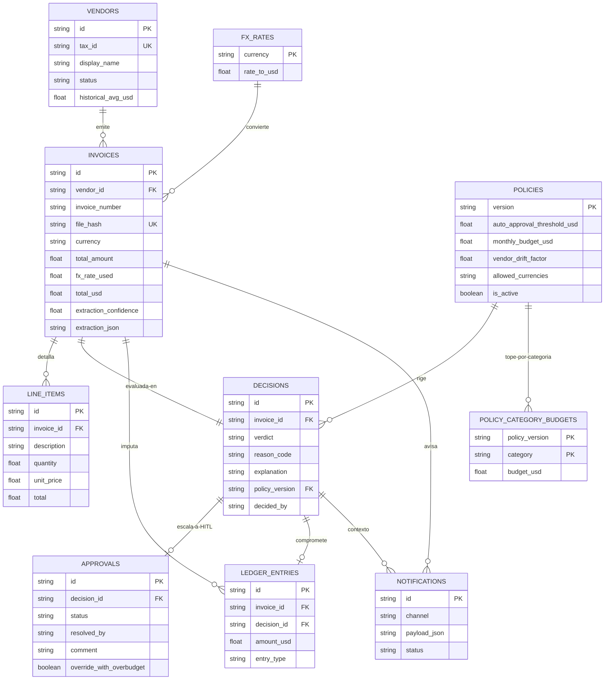

# Propuesta de Modelo ER — Faktur / Blinka PayAgent
### Diseño lógico SDD orientado a SQLite (sin DDL específico de motor)

> **Fuentes:** `docs/PRD_Faktur.md` + `docs/planteamiento_mvp_reto_blinka.md`
> **Objetivo:** persistir ingesta, extracción, decisión determinista, HITL y auditoría reproducible.
> **Alcance:** modelo conceptual + lógico + reglas de integridad. La implementación precisa en SQLite (DDL, índices, migraciones) queda **fuera de este scope**.
> **Metodología:** SDD — cada entidad traza a un requerimiento (RF-x del PRD o § del MVP).

---

## 0. Principios de diseño (decisiones SDD)

1. **El LLM no decide dinero.** Solo `invoices.datos_extraidos` guarda lo que el LLM percibió. La decisión vive en `decisions` y la toma código puro (PRD RF-2, RF-4; MVP §5).
2. **Fail-closed por defecto.** Si falta dato crítico o hay duplicado, el camino termina en `FRENAR`, nunca en `PAGAR` (MVP §2, §5).
3. **FRENAR ≠ ESCALAR.** `FRENAR` es inválido no-aprobable. `ESCALAR` es válido-pendiente de humano. Una aprobación humana **jamás** puede revertir un `FRENAR` (MVP §5).
4. **Auditoría reproducible.** Toda `decision` guarda `policy_version` usada. Cambiar reglas no reescribe historia (MVP §4).
5. **Dedup doble.** `invoices.file_hash UNIQUE` + `UNIQUE(vendor_id, invoice_number)` cubren archivo idéntico y tupla lógica (PRD RF-1, RF-4 orden 1).
6. **Presupuesto no se descuenta dos veces.** Solo `PAGAR` (autónomo o HITL-aprobado) genera movimiento en `ledger_entries`. `FRENAR` y `ESCALAR-pendiente` no mueven saldo (PRD RF-4).

---

## 1. Trazabilidad SDD (spec → entidad)

| Spec origen | Contenido | Entidades que lo cubren |
|---|---|---|
| PRD RF-1 + MVP §4 `invoices` | Ingesta, SHA-256, archivo original | `invoices` |
| PRD RF-2 + MVP §3 `/extract` | JSON tipado, validación, confianza | `invoices` + `line_items` |
| PRD RF-3 | Normalización a USD, tasa usada | `invoices.total_usd`, `invoices.fx_rate_used`, `fx_rates` |
| PRD RF-4 + MVP §5 | Motor 8 reglas, orden de precedencia | `decisions` + `policies` + `policy_category_budgets` + `vendors` |
| PRD RF-5 + MVP §4 `decisions` | AuditRecord, reason_code, motivo legible | `decisions` |
| PRD RF-7 + MVP §4 `approvals` | Bandeja HITL, aprueba/niega | `approvals` |
| MVP §4 `ledger` | Saldo del periodo | `ledger_entries` |
| MVP §4 `policy` + PRD RF-6.2 | Reglas configurables versionadas | `policies` + `policy_category_budgets` |
| PRD RF-6.6 + MVP §8 | Notificación (tarjeta Slack / webhook / outbox) | `notifications` (outbox, opcional pero barata) |
| PRD §7 TC-01..TC-10 | Set demo + ground truth | `demo_fixtures` (solo seed, no runtime) o fuera de DB |

---

## 2. Diccionario de entidades

### 2.1 `vendors` — proveedores / beneficiarios
Representa la whitelist/blacklist y el historial para vendor drift (PRD RF-4 reglas 4 y 6; MVP reglas 3-4).

- `id` — identificador interno (PK lógica, texto o entero autoincremental).
- `tax_id` — RFC / NIT / RUT / EIN normalizado en mayúsculas, sin espacios. **UNIQUE, NOT NULL.** Es la clave de negocio. `Entidad Fantasma` (TC-08) falla aquí por ausencia.
- `display_name` — razón social (`CloudServers Inc`, `DevStudio Latam`).
- `status` — `ALLOWLISTED | BLOCKLISTED | UNLISTED`. `UNLISTED` no se persiste (todo no-listado es ESCALAR por ausencia); se usa para el seed inicial.
- `historical_avg_usd` — promedio histórico para drift. Ej. `CLOUD-SERVERS-INC 420`, `DEVSTUDIO-LATAM 850`.
- `first_seen_at`, `last_seen_at` — para detectar proveedor nuevo (TC-05).

### 2.2 `invoices` — factura ingresada + extracción
Una fila por documento subido (MVP `invoices`; PRD `ExtractedInvoice` + `AuditRecord.invoice`).

- `id` — PK lógica (ej. `uuid8` del blueprint).
- `vendor_id` — FK → `vendors.id`, nulable (si no se pudo extraer proveedor, queda NULL y dispara FRENAR por dato crítico).
- `invoice_number` — folio (`INV-9022`). NOT NULL si extracción válida; combinado con `vendor_id` forma UNIQUE de negocio.
- `file_name`, `mime_type` — `factura.pdf`, `application/pdf`.
- `file_hash` — SHA-256 hex (64 chars). **UNIQUE, NOT NULL.** Base del anti-duplicado exacto.
- `issue_date`, `due_date` — fechas ISO-8601 (`YYYY-MM-DD`).
- `currency` — ISO 4217 (`USD`, `MXN`, `COP`, `EUR`). Debe estar en `fx_rates` o dispara FRENAR.
- `subtotal`, `tax_amount`, `total_amount` — montos originales.
- `fx_rate_used` — tasa aplicada al momento de evaluar.
- `total_usd` — `total_amount * fx_rate_used`, 2 decimales. Es lo que evalúa el motor.
- `extraction_confidence` — 0..1 promedio o mínimo por campo (MVP §3, §13). Baja confianza ⇒ ESCALAR.
- `extraction_json` — JSON crudo validado (para re-auditar sin re-llamar al LLM).
- `ingested_at` — timestamp de subida.

**Invariantes:**
- `UNIQUE(file_hash)`.
- `UNIQUE(vendor_id, invoice_number)` donde ambos no nulos (cubre TC-03 aunque cambie el nombre del archivo).
- `total_usd` siempre se calcula con la tasa vigente al evaluar, y se congela en la fila.

### 2.3 `line_items` — detalle de conceptos
Hija de `invoices` (PRD `LineItem[]`). No decide, pero sostiene explicabilidad y futura conciliación vs. OC.

- `id` — PK.
- `invoice_id` — FK → `invoices.id` (1:N, borrado en cascada lógica).
- `description`, `quantity`, `unit_price`, `total`.

### 2.4 `policies` — versión de política vigente al decidir
Implementa "reglas configurables" del reto (MVP §4 `policy`, §13 versionado; PRD RF-6.2).

- `version` — PK lógica (`v1`, `v2`, … o entero incremental). Cada `decision` la referencia.
- `auto_approval_threshold_usd` — default `1000.0` (PRD RF-4, TC-04).
- `monthly_budget_usd` — default `5000.0` (techo global demo).
- `vendor_drift_factor` — default `1.40` (TC-07).
- `allowed_currencies` — lista (`["USD","MXN","COP","EUR"]`). Moneda fuera ⇒ FRENAR.
- `is_active` — solo una activa a la vez (para el Policy Controller). El historial se conserva.
- `created_at`, `created_by`, `comment` — quién movió el slider y por qué (auditoría de la regla misma).

### 2.5 `policy_category_budgets` — presupuesto por categoría
Cubre TC-10 ("deja la categoría en negativo") y MVP regla 6. Sin esta tabla el presupuesto global no explica sobregiros por partida.

- `policy_version` — FK → `policies.version` (PK compuesta).
- `category` — PK compuesta (`Infraestructura`, `Nómina`, `Marketing`…).
- `budget_usd` — techo de la categoría en esa versión.

### 2.6 `fx_rates` — tasas de conversión
Hace explícita la tabla que el blueprint tenía en memoria (`exchange_rates`). Evita magia en código.

- `currency` — PK (`USD`, `MXN`, `COP`, `EUR`).
- `rate_to_usd` — `MXN 0.055, COP 0.00024, EUR 1.08, USD 1.0`.
- `as_of` — vigencia (v1: tasa fija seed; futuro: timestamp de API FX).

### 2.7 `decisions` — veredicto determinista (corazón auditable)
Equivale a `AuditRecord` (PRD RF-5) + MVP `decisions`. **Una factura tiene N decisiones en historia, pero una sola vigente.** Para v1 se recomienda `UNIQUE(invoice_id)` + nueva fila solo si se re-evalúa con otra `policy_version` (re-juego demo); la app lee la última.

- `id` — PK.
- `invoice_id` — FK → `invoices.id`, UNIQUE (v1).
- `verdict` — `PAGAR | FRENAR | ESCALAR`.
- `reason_code` — `SUCCESS_TOUCHLESS_STP | ERR_DUPLICATE_INVOICE | ERR_BUDGET_OVERRUN | ERR_INVALID_DATA | ERR_BLACKLISTED_VENDOR | ALERT_NEW_VENDOR | ALERT_THRESHOLD_EXCEEDED | ALERT_VENDOR_DRIFT | ALERT_BUDGET_TIGHT`.
- `explanation` — motivo legible no-técnico (la columna que gana explicabilidad).
- `policy_version` — FK → `policies.version`. **Obligatoria.** Permite reproducir por qué se decidió así aunque el slider se haya movido después.
- `amount_usd_evaluated` — copia congelada del `total_usd` evaluado.
- `decided_by` — `AGENTE | HUMANO` (las HITL-resueltas marcan `HUMANO`).
- `decided_at` — timestamp.

**Orden de precedencia** (no es entidad, es constraint de aplicación, MVP §5): 1 duplicado → 2 tupla → 3 blacklist/inválido → 4 no-listado → 5 sin OC/desviación → 6 presupuesto → 7 umbral → 8 PAGAR. El primero que dispara gana y define `reason_code`.

### 2.8 `approvals` — bandeja HITL
Solo existe si `decisions.verdict = ESCALAR` (MVP `approvals`; PRD RF-7).

- `id` — PK.
- `decision_id` — FK → `decisions.id`, UNIQUE (un ESCALAR, una bandeja).
- `invoice_id` — FK desnormalizada para consulta rápida de bandeja (`GET /approvals?status=pendiente`).
- `status` — `PENDIENTE | APROBADA | NEGADA`.
- `requested_at` — cuando escaló.
- `resolved_by`, `resolved_at`, `comment` — quién y por qué (`"Autorizada con sobrecupo"`, `"Rechazada: monto no acordado"`).
- `override_with_overbudget` — booleano (para la acción `[Autorizar con Sobrecupo]` del PRD RF-6.6).

**Invariantes:**
- No se puede crear `approval` sobre `FRENAR`. Intentarlo es error de aplicación.
- Transición única: `PENDIENTE → APROBADA | NEGADA`. `APROBADA` muta su `decision` a `PAGAR`; `NEGADA` la muta a `FRENAR` con sufijo manual. Segunda resolución ⇒ rechazo (`already_resolved`, PRD RF-7.3).
- Solo `APROBADA` genera movimiento en `ledger_entries`.

### 2.9 `ledger_entries` — compromisos del periodo (no dinero real)
Libro de saldos para calcular `budget_remaining` sin recalcular toda la historia (MVP `ledger`).

- `id` — PK.
- `invoice_id` — FK → `invoices.id`.
- `decision_id` — FK → `decisions.id` (trazabilidad pago ↔ veredicto).
- `policy_version` — copia de la versión que autorizó el compromiso.
- `amount_usd` — positivo (compromiso). V1 sin reversos; un reembolso futuro sería fila negativa.
- `entry_type` — `COMPROMISO_PAGAR` (v1 único valor; deja puerta a `AJUSTE`/`REVERSO`).
- `created_at` — para corte mensual.

`budget_remaining = policies.monthly_budget_usd − SUM(ledger_entries.amount_usd del periodo)`. Nunca se inserta si el veredicto final no es `PAGAR`.

### 2.10 `notifications` — outbox de avisos (opcional v1, recomendada)
Concreta la interfaz `Notifier` del MVP §8 sin atar la demo a Slack.

- `id` — PK.
- `invoice_id`, `decision_id` — contexto.
- `channel` — `SLACK_CARD | WEBHOOK | CONSOLE | EMAIL_LOCAL`.
- `payload_json` — lo que se mostraría (tarjeta estilo Slack).
- `status` — `PENDIENTE | ENVIADA | FALLIDA`.
- `created_at`.

Si hay que recortar para el hackathon, se recorta esta tabla (MVP §1: el 7 es sacrificable). El resto no.

---

## 3. Diagrama ER (Mermaid)

**Lectura rápida:** `vendors 1—N invoices 1—1 decisions 0..1 approvals`, `decisions 0..1 ledger_entries`, `policies 1—N decisions` (por versión), `policies 1—N category_budgets`.

---

## 4. Reglas de integridad (para implementar después en SQLite)

Sin sintaxis de motor (fuera de scope), en lenguaje de especificación:

1. **RI-1 Unicidad anti-doble-pago:** `invoices.file_hash UNIQUE`; `UNIQUE(vendor_id, invoice_number)` cuando ambos no nulos.
2. **RI-2 Decisión versionada obligatoria:** `decisions.policy_version NOT NULL` + FK a `policies.version`.
3. **RI-3 HITL solo sobre ESCALAR:** constraint de aplicación — `approvals` exige `decisions.verdict = ESCALAR` al crear; `FRENAR` nunca abre bandeja.
4. **RI-4 Transición única HITL:** `approvals.status` solo `PENDIENTE → APROBADA|NEGADA`; `decision_id UNIQUE` en `approvals`; segunda resolución rechazada.
5. **RI-5 Ledger solo PAGAR:** `ledger_entries` exige `decisions.verdict final = PAGAR` (autónomo o `APROBADA`). Prohibido insertar desde `FRENAR` o `PENDIENTE`.
6. **RI-6 Presupuesto coherente:** `monthly_budget_usd` y `policy_category_budgets.budget_usd` ≥ 0; `total_usd`, `amount_usd` ≥ 0.
7. **RI-7 Moneda cerrada:** `invoices.currency` debe existir en `fx_rates` y en `policies.allowed_currencies` de la versión activa; si no, FRENAR (no ESCALAR).
8. **RI-8 Inmutabilidad práctica:** `decisions` y `ledger_entries` son append-only; solo se permite `ESCALAR → PAGAR|FRENAR` vía `approvals` con `decided_by=HUMANO` y sufijo en `explanation`.
9. **RI-9 Tasa congelada:** `invoices.fx_rate_used` y `total_usd` no se recalculan si `fx_rates` cambia después; la re-evaluación crea nueva `decision` con nueva `policy_version`.
10. **RI-10 CSV reproducible:** toda fila del reporte (`invoice_id, proveedor, montos, estado, regla, motivo, requirió_humano, decidido_por, policy_version, timestamp`) debe poder reconstruirse con JOIN `invoices + vendors + decisions + approvals + policies`.

---

## 5. Cobertura de los 10 TC del PRD con este modelo

| TC | Cómo se representa |
|---|---|
| TC-01, TC-02, TC-09 (PAGAR) | `invoices` + `vendors` allowlisted + `decisions(PAGAR, SUCCESS_TOUCHLESS_STP, policy vX)` + `ledger_entries(COMPROMISO)` |
| TC-03 (duplicado) | Viola RI-1: mismo `file_hash` o misma tupla `(vendor_id, invoice_number)` → `decisions(FRENAR, ERR_DUPLICATE_INVOICE)` sin ledger |
| TC-04 (umbral) | `total_usd 3500 > policies.auto_approval_threshold_usd 1000` → `decisions(ESCALAR, ALERT_THRESHOLD_EXCEEDED)` + `approvals(PENDIENTE)` |
| TC-05 (nuevo) | `tax_id` sin fila en `vendors` → `decisions(ESCALAR, ALERT_NEW_VENDOR)` |
| TC-06 (EUR+presupuesto) | `fx_rates(EUR 1.08)` → `total_usd 5400`; si `> monthly_budget` → `FRENAR ERR_BUDGET_OVERRUN`, si no → `ESCALAR ALERT_*` |
| TC-07 (drift) | `total_usd 1200 > historical_avg_usd 480 * 1.40` → `ESCALAR ALERT_VENDOR_DRIFT` |
| TC-08 (fantasma) | `vendor_id NULL` / `tax_id` vacío → `FRENAR ERR_INVALID_DATA` (+ `BLOCKLISTED` si aplica) |
| TC-10 (categoría) | JOIN con `policy_category_budgets` insuficiente → `ESCALAR ALERT_BUDGET_TIGHT` |

---

## 6. Qué se deja fuera a propósito (y por qué)

- **Sin tabla `users` / RBAC / SSO.** V1 es demo local sin auth (MVP §9). `approvals.resolved_by` es texto libre (`"CFO-demo"`).
- **Sin `purchase_orders`.** MVP regla 5 ("no cuadra con lo acordado") se cubre en v1 con `vendors.historical_avg_usd` (drift), no con OC formal. OC real es fase 2.
- **Sin movimientos bancarios.** `ledger_entries` son compromisos, no pagos. Respeta "no mueve dinero real".
- **Sin `demo_fixtures` como tabla runtime.** El `ground_truth.json` vive como seed externo, no como entidad operativa.
- **Sin índices/SQLite DDL.** Fuera de scope por consigna; el modelo lógico ya deja las UK/FK listas para traducir a `UNIQUE`, `FOREIGN KEY`, `CHECK` cuando toque.

---

## 7. Siguiente paso sugerido (no implementado aquí)

1. Traducir §2 a 10 `CREATE TABLE` SQLite con `PRAGMA foreign_keys=ON`, `CHECK(verdict IN (...))`, e índices sobre `file_hash`, `(vendor_id, invoice_number)`, `decisions(invoice_id)`, `approvals(status)`.
2. Seed: 3 vendors + `policies v1` + 4 `fx_rates` + 10 fixtures TC.
3. Test SDD: insertar TC-03 duplicado debe fallar por RI-1; crear `approval` sobre `FRENAR` debe fallar por RI-3; doble-resolución debe fallar por RI-4.

*Risk: none — artefacto de diseño, sin cambios de código ni de datos.*
