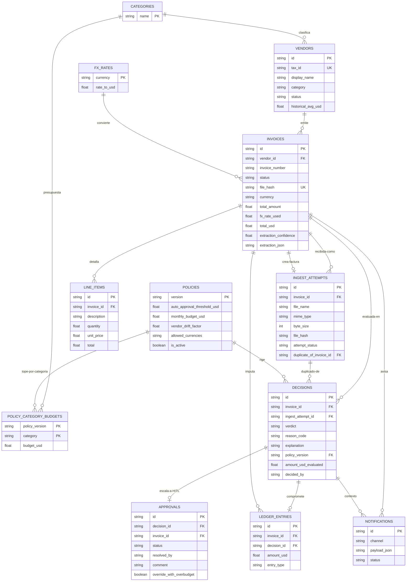

# Propuesta de Modelo ER — Faktur / Blinka PayAgent
### Diseño lógico SDD orientado a SQLite (sin DDL específico de motor)

> **Fuentes:** `docs/PRD_Faktur.md` + `docs/planteamiento_mvp_reto_blinka.md` + `diagramas/*.mmd`
> **Objetivo:** persistir ingesta, extracción, decisión determinista, HITL y auditoría reproducible.
> **Alcance:** modelo conceptual + lógico + reglas de integridad. La implementación precisa en SQLite (DDL, índices, migraciones) queda **fuera de este scope** y es la tarea T3 de `docs/backlog_implementacion_mvp.md`.
> **Metodología:** SDD — cada entidad traza a un requerimiento (RF-x del PRD o § del MVP).
>
> **Actualizado el 16/10/2026** para incorporar las decisiones de producto de `docs/backlog_implementacion_mvp.md` §7: tabla de intentos de ingesta, categoría en el proveedor, y 11 casos de prueba. El modelo anterior (10 entidades, RI-1 en un solo nivel, seed de 3 proveedores) queda superado.

---

## 0. Principios de diseño (decisiones SDD)

1. **El LLM no decide dinero.** Solo `invoices.extraction_json` guarda lo que el LLM percibió. La decisión vive en `decisions` y la toma código puro (PRD RF-2, RF-4; MVP §5).
2. **Fail-closed por defecto.** Si falta dato crítico o hay duplicado, el camino termina en `FRENAR`, nunca en `PAGAR` (MVP §2, §5).
3. **FRENAR ≠ ESCALAR.** `FRENAR` es inválido no-aprobable. `ESCALAR` es válido-pendiente de humano. Una aprobación humana **jamás** puede revertir un `FRENAR` (MVP §5; `diagramas/ds02`).
4. **Auditoría reproducible.** Toda `decision` guarda la `policy_version` usada. Cambiar reglas no reescribe historia (MVP §4).
5. **Dedup en dos niveles.** `invoices.file_hash` UNIQUE para la factura canónica, y `ingest_attempts` conserva todo intento de subida, incluidos los duplicados rechazados. El duplicado queda **auditable**, no descartado (decisión de producto Q1).
6. **Presupuesto no se descuenta dos veces.** Solo `PAGAR` (autónomo o HITL-aprobado) genera movimiento en `ledger_entries`. `FRENAR` y `ESCALAR`-pendiente no mueven saldo (PRD RF-4).
7. **La categoría es del proveedor, no de la factura.** `vendors.category` gobierna el presupuesto por categoría; una factura sin proveedor frena antes de llegar a esa regla (decisión de producto Q3).
8. **`decisions` es append-only.** El veredicto original nunca se muta. El estado actual vive en `invoices.status`, y la resolución humana es una fila nueva en `approvals` más un evento de auditoría.

---

## 1. Trazabilidad SDD (spec → entidad)

| Spec origen | Contenido | Entidades que lo cubren |
|---|---|---|
| PRD RF-1 + MVP §4 `invoices` | Ingesta, SHA-256, archivo original | `invoices` + `ingest_attempts` |
| PRD RF-2 + MVP §3 `/extract` | JSON tipado, validación, confianza | `invoices` + `line_items` |
| PRD RF-3 | Normalización a USD, tasa usada | `invoices.total_usd`, `invoices.fx_rate_used`, `fx_rates` |
| PRD RF-4 + MVP §5 | Motor 8 reglas, orden de precedencia | `decisions` + `policies` + `policy_category_budgets` + `vendors` |
| PRD RF-5 + MVP §4 `decisions` | AuditRecord, reason_code, motivo legible | `decisions` |
| PRD RF-7 + MVP §4 `approvals` | Bandeja HITL, aprueba/niega | `approvals` |
| MVP §4 `ledger` | Saldo del periodo | `ledger_entries` |
| MVP §4 `policy` + PRD RF-6.2 | Reglas configurables versionadas | `policies` + `policy_category_budgets` |
| PRD RF-6.6 + MVP §8 | Notificación (tarjeta Slack / webhook / outbox) | `notifications` |
| MVP §7 TC-01..TC-12 | Set demo + ground truth | seed externo, no entidad operativa |

---

## 2. Diccionario de entidades

### 2.0 `categories` — categorías de gasto (fuente de verdad)

Nueva (decisión de producto Q3 + RI-12). Es la fuente de verdad de las 6 categorías que consumen presupuesto. Tanto `vendors.category` como `policy_category_budgets.category` referencian esta tabla, lo que garantiza que una categoría inventada en un proveedor o en un budget no pase la validación.

- `name` — PK. Los mismos valores que el enum de T2: `Infraestructura`, `Diseno`, `Marketing`, `Legal`, `Software`, `Retail`. Sin tilde por §6.5.

**Seed v1:** las 6 categorías.

### 2.1 `vendors` — proveedores / beneficiarios
Representa la whitelist/blacklist, la categoría que gobierna el presupuesto y el promedio histórico para drift.

- `id` — PK lógica (TEXT, UUID v4 generado en la capa de aplicación). `tax_id` es la clave de negocio.
- `tax_id` — RFC / NIT / RUT / EIN normalizado en mayúsculas, sin espacios. **UNIQUE, NOT NULL.** Es la clave de negocio. `Entidad Fantasma` (TC-08) falla aquí por ausencia.
- `display_name` — razón social (`CloudServers Inc`, `DevStudio Latam`).
- `category` — **nuevo.** Categoría de gasto que consume presupuesto. FK → `categories.name`. Es lo que permite que la regla 6 evalúe el saldo por categoría (decisión de producto Q3).
- `status` — `ALLOWLISTED | BLOCKLISTED`. Un proveedor desconocido **no se persiste**: su veredicto es ESCALAR por ausencia (TC-05), no por fila.
- `historical_avg_usd` — promedio histórico para drift. Ej. `CLOUD-SERVERS-INC 420`, `FREELANCE-DESIGN 480`.
- `first_seen_at`, `last_seen_at` — para detectar proveedor nuevo.

**Seed v1: 8 proveedores** (decisión de producto Q2), derivados del set de casos:

| `tax_id` | `display_name` | `category` | `status` | `historical_avg_usd` | Casos |
|:---|:---|:---|:---|---:|:---|
| `CLOUD-SERVERS-INC` | CloudServers Inc | Infraestructura | ALLOWLISTED | 420 | TC-01, TC-03 |
| `DEVSTUDIO-LATAM` | DevStudio Latam | Diseno | ALLOWLISTED | 850 | TC-02, TC-10 |
| `GROWTH-AGENCY` | Growth Agency | Marketing | ALLOWLISTED | 3000 | TC-04 |
| `LEGAL-GLOBAL` | Legal Global | Legal | ALLOWLISTED | 4000 | TC-06 |
| `FREELANCE-DESIGN` | Freelance Design | Diseno | ALLOWLISTED | 480 | TC-07 |
| `SAAS-TOOLS-LTD` | SaaS Tools Ltd | Software | ALLOWLISTED | 120 | TC-09 |
| `AWS-AMAZON` | AWS Amazon | Infraestructura | ALLOWLISTED | 350 | sin caso propio |
| `VENTA-POS-DUO` | Venta Pos Duo | Retail | **BLOCKLISTED** | 0 | TC-11 |

La whitelist de 3 proveedores del PRD RF-4 **no alcanza**: TC-04, TC-07, TC-09 y TC-10 nombran proveedores que no están en ella, y entonces la regla 4 (proveedor nuevo) dispararía antes que la regla que el caso narraría.

### 2.2 `invoices` — factura canónica + extracción
Una fila por **documento lógico aceptado**, no por intento de subida.

- `id` — PK lógica.
- `vendor_id` — FK → `vendors.id`, nulable (si no se pudo extraer proveedor, queda NULL y dispara FRENAR por dato crítico).
- `invoice_number` — folio (`INV-9022`). Combinado con `vendor_id` forma UNIQUE de negocio.
- `status` — ciclo de vida de 7 estados, según `diagramas/estados_factura`: `recibida | extraida | decidida | pendiente_aprobacion | aprobada | negada | frenada`. Es el estado **actual**; el veredicto original inmutable vive en `decisions.verdict`.
- `file_name`, `mime_type` — `factura.pdf`, `application/pdf`.
- `file_hash` — SHA-256 hex (64 chars). **UNIQUE, NOT NULL.** Base del anti-duplicado exacto a nivel de factura canónica.
- `issue_date`, `due_date` — fechas ISO-8601 (`YYYY-MM-DD`).
- `currency` — ISO 4217 (`USD`, `MXN`, `COP`, `EUR`). FK → `fx_rates.currency`. Si no está en `fx_rates`, dispara FRENAR (RI-7).
- `subtotal`, `tax_amount`, `total_amount` — montos originales.
- `fx_rate_used` — tasa aplicada al momento de evaluar.
- `total_usd` — `total_amount * fx_rate_used`, 2 decimales. Es lo que evalúa el motor.
- `extraction_confidence` — 0..1. Bajo el umbral dispara ESCALAR por la regla 1.
- `extraction_json` — JSON crudo validado (para re-auditar sin re-llamar al LLM).
- `ingested_at` — timestamp de subida.

**Invariantes:**
- `UNIQUE(file_hash)`.
- `UNIQUE(vendor_id, invoice_number)` donde ambos no nulos (cubre TC-03 aunque cambie el nombre del archivo).
- `total_usd` siempre se calcula con la tasa vigente al evaluar, y se congela en la fila.
- Toda transición prohibida del diagrama de estados responde 409: `frenada → aprobada`, `negada → aprobada`, `aprobada → frenada`, `decidida → pendiente_aprobacion`.

### 2.3 `ingest_attempts` — todo intento de subida
**Nueva** (decisión de producto Q1). Hace auditable el reenvío duplicado sin romper el `UNIQUE` de `invoices.file_hash`.

- `id` — PK.
- `invoice_id` — FK → `invoices.id`, nulable. Se llena solo si este intento creó la factura canónica.
- `file_name`, `mime_type`, `byte_size` — lo recibido.
- `file_hash` — SHA-256. **Indexado, NO único**: el mismo archivo puede tener muchos intentos.
- `attempt_status` — `RECIBIDA | DUPLICADA | RECHAZADA`.
- `duplicate_of_invoice_id` — FK → `invoices.id`, nulable. Apunta a la factura canónica cuando `attempt_status = DUPLICADA`.
- `submitted_at` — timestamp de la subida.

**Invariantes:**
- Un `file_hash` repetido **no** crea fila en `invoices`: crea un intento `DUPLICADA` con su decisión FRENAR.
- Todo intento que llega a decisión tiene exactamente una fila en `decisions`, anclada por `ingest_attempt_id`.

### 2.4 `line_items` — detalle de conceptos
Hija de `invoices`. No decide, pero sostiene explicabilidad y futura conciliación contra orden de compra.

- `id` — PK.
- `invoice_id` — FK → `invoices.id`.
- `description`, `quantity`, `unit_price`, `total`.

### 2.5 `policies` — versión de política vigente al decidir
Implementa "reglas configurables" del reto (MVP §4 `policy`, §13 versionado; PRD RF-6.2).

- `version` — PK lógica (`v1`, `v2`, …). Cada `decision` y cada `approval` la referencia.
- `auto_approval_threshold_usd` — default `1000.0` (TC-04).
- `monthly_budget_usd` — default `5000.0` (techo global demo).
- `vendor_drift_factor` — default `1.40` (TC-07).
- `allowed_currencies` — lista (`["USD","MXN","COP","EUR"]`). Moneda fuera ⇒ FRENAR.
- `is_active` — solo una activa a la vez. El historial se conserva.
- `created_at`, `created_by`, `comment` — quién movió el slider y por qué.

### 2.6 `policy_category_budgets` — presupuesto por categoría
Cubre TC-10 ("deja la categoría en negativo") y la segunda mitad de la regla 6. Sin esta tabla el presupuesto global no explica sobregiros por partida.

- `policy_version` — FK → `policies.version` (PK compuesta).
- `category` — PK compuesta. FK → `categories.name`. Los mismos valores que `vendors.category`.
- `budget_usd` — techo de la categoría en esa versión.

**Seed v1:** `Infraestructura 1500`, `Diseno 1000`, `Marketing 4000`, `Legal 3000`, `Software 500`, `Retail 0`.

### 2.7 `fx_rates` — tasas de conversión
Hace explícita la tabla que el blueprint tenía en memoria. Evita magia en código.

- `currency` — PK.
- `rate_to_usd` — `USD 1.0`, `MXN 0.055`, `COP 0.00024`, `EUR 1.08`.
- `as_of` — vigencia (v1: tasa fija seed; futuro: timestamp de API FX).

### 2.8 `decisions` — veredicto determinista (corazón auditable)
Equivale a `AuditRecord` (PRD RF-5). **Append-only** (RI-8).

- `id` — PK.
- `invoice_id` — FK → `invoices.id`, **nulable**.
- `ingest_attempt_id` — FK → `ingest_attempts.id`, **nulable**. Mutuamente excluyente con `invoice_id`: las decisiones de un reenvío duplicado se anclan al intento para no crear una factura fantasma.
- `verdict` — `PAGAR | FRENAR | ESCALAR`.
- `reason_code` — uno de los **diez** del §2.8.1.
- `explanation` — motivo legible no-técnico, redactado en lenguaje natural con los números concretos. La columna que gana explicabilidad.
- `policy_version` — FK → `policies.version`. **Obligatoria.** Permite reproducir por qué se decidió así aunque el slider se haya movido después.
- `amount_usd_evaluated` — copia congelada del `total_usd` evaluado.
- `decided_by` — `AGENTE | HUMANO`.
- `decided_at` — timestamp.

> **Cambio respecto de la versión anterior de este documento:** la v1 decía a la vez `UNIQUE(invoice_id)` (1:1) y "N decisiones, nueva fila si se re-evalúa", lo que era una contradicción. Ahora queda resuelto: **no hay `UNIQUE`**, una factura puede tener varias decisiones a lo largo del tiempo, y la app lee la última. La resolución humana **no** muta `decisions`: escribe una fila nueva en `approvals` y mueve `invoices.status`. Así `explanation` de un registro inmutable nunca se reescribe.

#### 2.8.1 `reason_code` canónicos (diez)

| Regla | Condición | Veredicto | `reason_code` |
|:--|:---|:---|:---|
| 1 | Datos críticos ilegibles o incompletos | FRENAR | `ERR_INVALID_DATA` |
| 1 | Datos completos, confianza bajo el umbral | ESCALAR | `ALERT_LOW_CONFIDENCE` |
| 2 | Duplicado: hash o `(vendor, numero_factura)` | FRENAR | `ERR_DUPLICATE_INVOICE` |
| 3 | Beneficiario bloqueado | FRENAR | `ERR_BLACKLISTED_VENDOR` |
| 4 | Beneficiario no listado | ESCALAR | `ALERT_NEW_VENDOR` |
| 5 | No cuadra con lo acordado (drift) | ESCALAR | `ALERT_VENDOR_DRIFT` |
| 6 | Presupuesto del periodo insuficiente | ESCALAR | `ALERT_BUDGET_OVERRUN` |
| 6 | Presupuesto de categoría insuficiente | ESCALAR | `ALERT_BUDGET_TIGHT` |
| 7 | Supera el umbral de aprobación autónoma | ESCALAR | `ALERT_THRESHOLD_EXCEEDED` |
| 8 | Pasa todo lo anterior | PAGAR | `SUCCESS_TOUCHLESS_STP` |

El `ERR_BUDGET_OVERRUN` del PRD Apéndice A **queda sin uso**: ese veredicto FRENAR contradice `diagramas/estados_factura`, donde la regla 6 es escalable. Lo reemplaza `ALERT_BUDGET_OVERRUN`, y `ALERT_LOW_CONFIDENCE` cubre la rama de confianza baja de la regla 1, que ningún código del Apéndice A representaba.

### 2.9 `approvals` — bandeja HITL
Solo existe si `decisions.verdict = ESCALAR`.

- `id` — PK.
- `decision_id` — FK → `decisions.id`, UNIQUE (un ESCALAR, una bandeja).
- `invoice_id` — FK desnormalizada para consulta rápida de bandeja.
- `status` — `PENDIENTE | APROBADA | NEGADA`.
- `requested_at` — cuándo escaló.
- `resolved_by`, `resolved_at`, `comment` — quién y por qué.
- `override_with_overbudget` — booleano para la acción "Autorizar con Sobrecupo" (v1 puede ser visual).

**Invariantes:**
- No se puede crear `approval` sobre `FRENAR`.
- Transición única: `PENDIENTE → APROBADA | NEGADA`. Segunda resolución ⇒ **200 idempotente** sin cambios y sin duplicar el pago (`diagramas/ds02`).
- Aprobar re-chequea las reglas 1-3 con la `policy_version` del caso; si alguna dispara, responde 409.
- Solo `APROBADA` genera movimiento en `ledger_entries`.

### 2.10 `ledger_entries` — compromisos del periodo (no dinero real)
- `id` — PK.
- `invoice_id` — FK → `invoices.id`.
- `decision_id` — FK → `decisions.id`.
- `policy_version` — copia de la versión que autorizó el compromiso.
- `amount_usd` — positivo. V1 sin reversos.
- `entry_type` — `COMPROMISO_PAGAR` (v1 único valor).
- `created_at` — para corte mensual.

`budget_remaining = policies.monthly_budget_usd − SUM(ledger_entries.amount_usd del periodo)`. Nunca se inserta si el veredicto final no es `PAGAR`.

### 2.11 `notifications` — outbox de avisos
- `id` — PK.
- `invoice_id`, `decision_id` — contexto.
- `channel` — `SLACK_CARD | WEBHOOK | CONSOLE | EMAIL_LOCAL`.
- `payload_json` — lo que se mostraría.
- `status` — `PENDIENTE | ENVIADA | FALLIDA`.
- `created_at`.

Si hay que recortar para el hackathon, se recorta esta tabla (MVP §1: el 7 es sacrificable). El resto no.

### 2.12 `ai_explanations` — explicación con IA (post-MVP)
- `id` — PK.
- `invoice_id` — FK → `invoices.id` (ON DELETE CASCADE).
- `decision_id` — FK → `decisions.id` (ON DELETE CASCADE). **Clave de caché**: una explicación se ancla a la decisión que explica; si la factura se re-evalúa (nueva decisión), la explicación vieja no se sirve.
- `policy_version` — FK → `policies.version`: la política congelada de esa decisión.
- `model` — modelo Gemini usado.
- `prompt_version` — versión del prompt (auditoría/reproducibilidad).
- `explanation` — texto en lenguaje natural, ≤ 1500 caracteres.
- `created_at`.

La IA **explica** la decisión determinista y sugiere pasos; no la cambia ni la cuestiona. Persistir evita repetir el costo de la llamada y mantiene el audit trail.

---

## 3. Diagrama ER (Mermaid)

**Lectura rápida:** `categories 1—N vendors`, `categories 1—N policy_category_budgets`, `vendors 1—N invoices`, `ingest_attempts N—0..1 invoices`, `invoices 1—N decisions`, `decisions 0..1 approvals`, `decisions 0..1 ledger_entries`, `policies 1—N decisions`, `policies 1—N category_budgets`.

---

## 4. Reglas de integridad

1. **RI-1 Unicidad anti-doble-pago, en dos niveles:** `invoices.file_hash UNIQUE` + `UNIQUE(vendor_id, invoice_number)` sobre `invoices`; y `ingest_attempts.file_hash` **indexado pero no único**, de modo que un reenvío se registre y se frene en vez de rechazarse en silencio.
2. **RI-2 Decisión versionada obligatoria:** `decisions.policy_version NOT NULL` + FK a `policies.version`.
3. **RI-3 HITL solo sobre ESCALAR:** constraint de aplicación — `approvals` exige `decisions.verdict = ESCALAR` al crear; `FRENAR` nunca abre bandeja.
4. **RI-4 Transición única HITL:** `approvals.status` solo `PENDIENTE → APROBADA|NEGADA`; `decision_id UNIQUE` en `approvals`; segunda resolución devuelve 200 idempotente sin cambios.
5. **RI-5 Ledger solo PAGAR:** `ledger_entries` exige veredicto final `PAGAR` (autónomo o `APROBADA`). Prohibido insertar desde `FRENAR` o `PENDIENTE`.
6. **RI-6 Presupuesto coherente:** montos `>= 0`; `monthly_budget_usd` y `policy_category_budgets.budget_usd` `>= 0`.
7. **RI-7 Moneda cerrada:** `invoices.currency` debe existir en `fx_rates` y en `policies.allowed_currencies` de la versión activa; si no, FRENAR.
8. **RI-8 Inmutabilidad práctica:** `decisions` y `ledger_entries` son append-only. La resolución humana no muta `decisions.explanation`: escribe en `approvals` y mueve `invoices.status`.
9. **RI-9 Tasa congelada:** `invoices.fx_rate_used` y `total_usd` no se recalculan si `fx_rates` cambia; la re-evaluación crea nueva `decision` con nueva `policy_version`.
10. **RI-10 CSV reproducible:** toda fila del reporte debe poder reconstruirse con JOIN `ingest_attempts + invoices + vendors + decisions + approvals + policies`.
11. **RI-11 Ancla de decisión:** `decisions` tiene exactamente uno de `invoice_id` o `ingest_attempt_id`, nunca ambos ni ninguno.
12. **RI-12 Categoría cerrada:** `vendors.category` y `policy_category_budgets.category` referencian `categories.name`. Una categoría inventada en un proveedor o en un budget no pasa la validación del DDL. La coherencia con la política activa (que la categoría exista en los budgets de la versión vigente) se verifica en la capa de aplicación (T5/T8).

---

## 5. Cobertura de los 11 TC con este modelo

| TC | Cómo se representa | Regla |
|:--|:---|:--:|
| TC-01, TC-02, TC-09 (PAGAR) | `invoices` + `vendors` allowlisted + `decisions(PAGAR, SUCCESS_TOUCHLESS_STP, v1)` + `ledger_entries` | 8 |
| TC-03 (duplicado) | `ingest_attempts(DUPLICADA, duplicate_of_invoice_id → TC-01)` + `decisions(FRENAR, ERR_DUPLICATE_INVOICE)` anclada al intento. **Sin** fila nueva en `invoices`, **sin** ledger | 2 |
| TC-04 (umbral) | `total_usd 3500 > auto_approval_threshold_usd 1000` → `decisions(ESCALAR, ALERT_THRESHOLD_EXCEEDED)` + `approvals(PENDIENTE)` | 7 |
| TC-05 (nuevo) | `tax_id` sin fila en `vendors` → `decisions(ESCALAR, ALERT_NEW_VENDOR)`, sin proveedor creado | 4 |
| TC-06 (EUR + presupuesto) | `fx_rates(EUR 1.08)` → `total_usd 5400`; `5400 > 5000` → `decisions(ESCALAR, ALERT_BUDGET_OVERRUN)` | 6 |
| TC-07 (drift) | `total_usd 1200 > historical_avg_usd 480 * 1.40` → `ESCALAR, ALERT_VENDOR_DRIFT` | 5 |
| TC-08 (fantasma) | `vendor_id NULL` / `tax_id` vacío → `FRENAR, ERR_INVALID_DATA` | 1 |
| TC-10 (categoría) | `vendors.category = Diseno`, saldo `1000 − 850 (TC-02) = 150`; `950 > 150` → `ESCALAR, ALERT_BUDGET_TIGHT` | 6 |
| TC-11 (bloqueado) | `vendors.status = BLOCKLISTED` → `FRENAR, ERR_BLACKLISTED_VENDOR` | 3 |
| TC-12 (confianza baja) | `invoices.extraction_confidence 0.5 < min_extraction_confidence 0.7` → `ESCALAR, ALERT_LOW_CONFIDENCE`, con aprobación pendiente | 1 |

**Verificado:** los 12 casos salen del mismo motor con las mismas 8 reglas, sin código especial por caso. El runner de `docs/backlog_implementacion_mvp.md` T6 es el que lo comprueba en cada corrida, y además afirma que el conjunto de `reason_code` que produjo es igual al enum completo: los diez tienen al menos un caso, y `ALERT_LOW_CONFIDENCE` lo tiene recién con TC-12.

---

## 6. Qué se deja fuera a propósito (y por qué)

- **Sin tabla `users` / RBAC / SSO.** V1 es demo local sin auth (MVP §9). `approvals.resolved_by` es texto libre (`"CFO-demo"`).
- **Sin `purchase_orders`.** La regla 5 ("no cuadra con lo acordado") se cubre en v1 con `vendors.historical_avg_usd` (drift), no con OC formal. OC real es fase 2.
- **Sin movimientos bancarios.** `ledger_entries` son compromisos, no pagos.
- **Sin `demo_fixtures` como tabla runtime.** El `ground_truth.json` vive como seed externo.
- **Sin `notifications` si hay que recortar.** Es lo primero sacrificable del MVP §1.

---

## 7. Siguiente paso

La traducción a DDL es la tarea **T3** de `docs/backlog_implementacion_mvp.md`, junto con el seed de los 8 proveedores, `policies v1` con budgets por categoría, y 4 `fx_rates`. El diagrama en `diagramas/er.mmd` y `diagramas/er.dbml` está sincronizado con este documento.